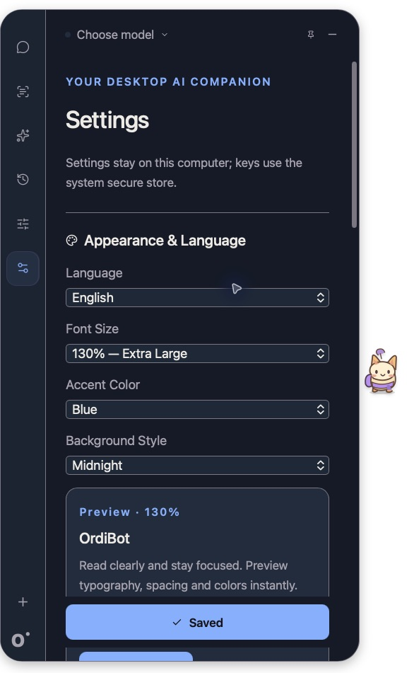
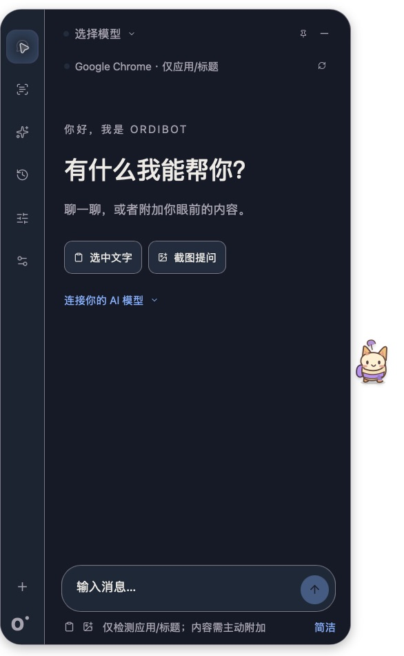
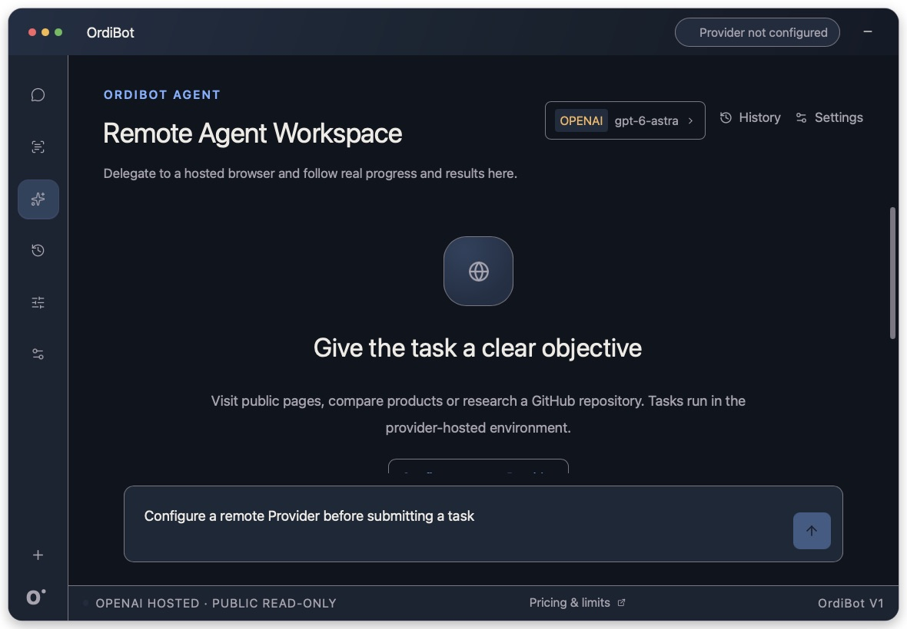

# G6.1 字体、语言与外观验收

[English](G6_1_ACCEPTANCE.md) | [简体中文](G6_1_ACCEPTANCE.zh-CN.md)

2026-10-12 · [Issue #20](https://github.com/Btkkgo/OrdiBot/issues/20) · [PR #21](https://github.com/Btkkgo/OrdiBot/pull/21)。

已验证的本地 Mac release 来自 `f5cb3fe`，程序 SHA-256 为 `d3fa54b4efb2639675b1ed4542d1556d9571fb8d5d11ec54b166be928f8fbee5`。原生操作前核查构建记录、ad-hoc 签名和确切应用路径；后续纯文档修改复用该程序。

| 验收项 | 结果 | 证据与边界 |
| --- | --- | --- |
| 活跃界面语言 | PASS | 实际 Mac 应用中文 → English → 中文即时切换，检查 Chat、Context、History、Models、Settings 和 Agent 文案。自定义托盘菜单代码随语言切换；系统自有菜单遵循平台语言。 |
| 五档字号 | PASS | Mac 实际选择 90/100/110/120/130 并即时预览，默认 14px 系统字体，文字/间距同步缩放；原创宠物尺寸与 SVG 造型保留。 |
| 130% 排版 | PASS | 实际中英 Chat/Agent、Settings 和 Models，文字换行、控件可读、表单/任务示例可滚动。原生 Agent 为无任务界面，已有任务/审批文案由组件 fixture 覆盖，未执行真实 Provider 任务。 |
| 强调色/背景 | PASS | 原生应用选择全部五种强调色和三种背景。15 种配色组合检查正文/辅助文字/按钮对比度 ≥4.5:1，焦点/边框 ≥3:1。 |
| 持久化/重置 | PASS | 保存 English/130/Blue/Midnight，退出并重新启动确切 release 后选中值与主题恢复；重置并保存中文/100/Purple/Graphite。与任务前私有恢复副本比较，原有配置值、历史、停靠及窗口尺寸一致。 |
| 保存失败 | PASS | 原生无效 HTTP 地址在保存前被拒绝，显示英文错误，按钮未声称 Saved；恢复原地址后正常保存。实际组件测试亦覆盖 SETTINGS_WRITE_FAILED，未向该地址发送请求。 |
| Edge/Chat/Agent 回归 | PASS | 点击 Edge 展开，Chat/Agent 切换恢复窄窗口，收起保留探头，重启记忆停靠；检查英文 Edge 标签。已有富内容采集适配器未改。 |
| 兼容性 | PASS | 无新字段的旧 Stored 加载默认值，非空对话/任务/窗口 fixture 持久化并重新加载后保留；拒绝无效新预设。凭据命名空间未变。 |
| TypeScript | PASS | 共 99 个：桌面 90 + contracts 9；字典键/占位符完整，用户/Provider 原文保留。 |
| Rust | PASS | 活跃默认成员共 37 个测试，含三个新增兼容/预设回归。 |
| 类型/构建/签名 | PASS | TypeScript 类型检查、前端构建及已核查的 Mac 原生 release。 |
| 审查 | PASS | 三处 Important 状态时序问题已修复：完整 Config 夹带到预览、原生 snapshot 重置草稿、旧 Edge 读取覆盖新预览。真实 DOM 生命周期/事件顺序回归先失败后通过，无未解决 Critical/Important/Minor。 |
| Windows CI | PASS | 独立[分支执行](https://github.com/Btkkgo/OrdiBot/actions/runs/38236081002)和[PR 执行](https://github.com/Btkkgo/OrdiBot/actions/runs/38236236446)通过测试/类型检查/原生 NSIS 构建，安装包已下载。 |
| Windows 界面/字体/上下文 | NOT VERIFIED | 未操作真实 Windows 桌面，CI 编译单独记录。 |
| 真实 Chat/Vision/Remote Agent | NOT RUN / OWNER DEFERRED | 本轮不执行，生产调用 0，无新增 Agent 能力。 |

未删除原 OrdiBot 存储、OrdinConn 备份、旧凭据或独立机器人项目。新增字段沿用 serde 默认值及原子存储。下方截图仅为应用界面，不含私有桌面截图、密钥或用户内容。菜单栏/快捷键与窗口标题既有限制继续由 Issue #17 跟踪，本记录不代表完整 V1 验收。G6.1 未重复执行新二进制录屏授权刷新，此前 V1 截图证据单独保留。

## 已检查的原生界面截图

