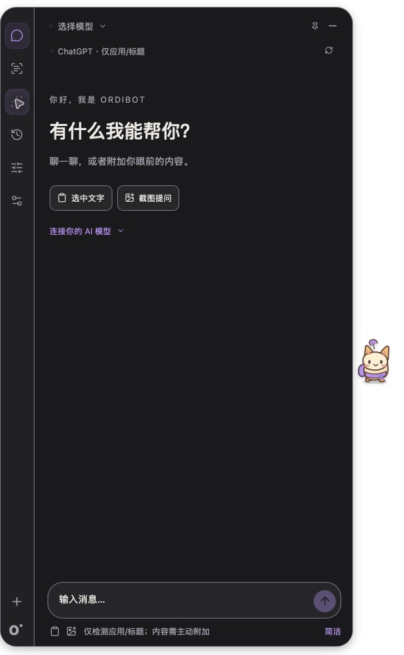
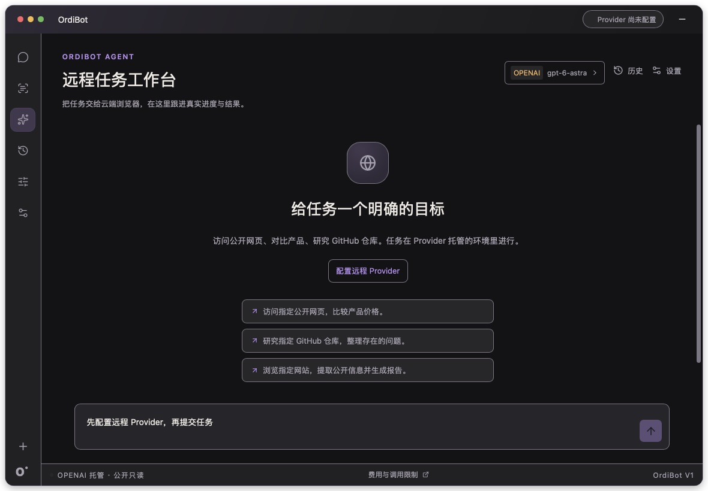

# G6.2 V1 验收与加固

[English](G6_2_ACCEPTANCE.md) | [简体中文](G6_2_ACCEPTANCE.zh-CN.md)

2026-10-12 · [#22](https://github.com/Btkkgo/OrdiBot/issues/22) · 父 [#17](https://github.com/Btkkgo/OrdiBot/issues/17) 保持开启。基线 main `061d217`。本轮是验证任务，不代表完整 V1 通过。

## 结果定义

PASS：实际执行通过。FAIL：实际执行未达标准。NOT VERIFIED：已尝试或有代码证据，但未取得验收证据。NOT RUN：未执行。OWNER DEFERRED：用户明确暂缓，执行仍为 NOT RUN。组件/CI 与原生/真实 Provider 分开记录。

## Mac 矩阵

| 项目 | 结果 | 证据 / 边界 |
| --- | --- | --- |
| G6.1 实际进程/构建记录/签名 | PASS | 新 G6.2 release 记录为 350d2ca；程序 SHA-256 d3fa54b4efb2639675b1ed4542d1556d9571fb8d5d11ec54b166be928f8fbee5 与 G6.1 一致。确认旧进程退出后重建并打开确切包；本地签名验证通过。 |
| Edge 点击/收起 | PASS | 原生探头展开 Chat，收起后探头保留。 |
| 菜单栏隐藏/打开、Agent/Edge | PASS | 用户在当前应用物理操作并确认全部成功。单列为用户操作/报告证据；工具无法读取 SystemUIServer。 |
| Edge 全局快捷键 | PASS | 设置显示注册成功，用户物理按下 Cmd+Shift+Space 并报告恢复成功。工具注入未触发，未建立应用缺陷。 |
| Agent/Chat 与重启恢复 | PASS | 重启保留 Edge 与原偏好；实际 Chat 586×951 → Agent 1180×820 → Chat 586×951，截图及私有存储比较一致。 |
| 原生 Window 关闭/最小化恢复 | NOT VERIFIED | 工具菜单尝试未观察到表面变化，已请求用户物理确认；与收起/Edge/菜单栏恢复分开。 |
| 当前二进制截图预览/取消/确认/移除 | PASS | 最初旧 OS 授权拒绝截图，仅移除旧 OrdiBot 条目，用户添加/开启确切验证包并重新打开。实际预览出现；取消无附件，确认附加截图，移除清空；未发送消息，像素未公开或发送 Provider。 |
| 测试/类型检查 | PASS | 新执行 99 TypeScript / 37 Rust，类型检查通过。 |
| Mac release 重建 | PASS | npm run desktop:build 的前端/类型、release 构建、来源记录和本地签名通过。运行时代码未变化。 |
| 数据/配置保留 | PASS | 所有配置、对话/任务记录和 Chat 宽高与操作前私有副本一致；凭据命名空间未变，未读取凭据。 |

## Windows 矩阵

| 项目 | 结果 | 证据 / 边界 |
| --- | --- | --- |
| 真实 Windows 11 GUI 环境 | NOT RUN | 当前工具仅 macOS，未发现运行/安装的 Windows VM；未提供远程 Windows GUI。 |
| 中英文、五档字体、15 种主题组合 | NOT RUN | 必须真实 Windows GUI；不用 Mac 或测试代替。 |
| Chat/Agent/Settings、Edge 停靠/上下文 | NOT RUN | 必须真实 Windows GUI，不模拟验收。 |
| 新独立 Windows CI 原生安装包 | PASS | [Workflow dispatch 38257016271](https://github.com/Btkkgo/OrdiBot/actions/runs/38257016271)，提交 350d2ca：npm 测试/类型、cargo 测试、NSIS 构建/上传通过，安装包已下载，不代表 GUI。 |

## Provider 矩阵

| 项目 | 执行 | 决定 |
| --- | --- | --- |
| 真实 Chat / 流式 / 取消 / 错误 | NOT RUN | OWNER DEFERRED |
| Vision / 截图模型回复 | NOT RUN | OWNER DEFERRED |
| Remote Agent 提交 / 状态 / 审批 / 结果 | NOT RUN | OWNER DEFERRED |

不读取或使用生产凭据，生产 Provider 调用 0，不新增 Agent。原数据库/备份/凭据及独立机器人项目保留。私有配置副本仅本地保存。G6.1 验收单独保留。

## 加固结果与 V1 剩余验收

未建立可复现运行时代码缺陷，未修改产品代码/依赖/Agent 能力或已通过 G6.1 行为。本轮必要本地修复是在用户参与下通过系统设置仅刷新 OrdiBot 既有录屏授权；未绕过权限或重置其他条目。

父 #17 保持 NEEDS_VALIDATION 和开启：真实 Windows 11 GUI/上下文、真实 Provider、前台窗口标题可用性（观察仍退化为仅应用）及原生关闭/最小化物理确认分开保留。菜单/快捷键依赖用户操作报告，非工具注入通过。当前二进制截图已验证；旧 V1 证据仍为历史。

## 原生应用界面截图

